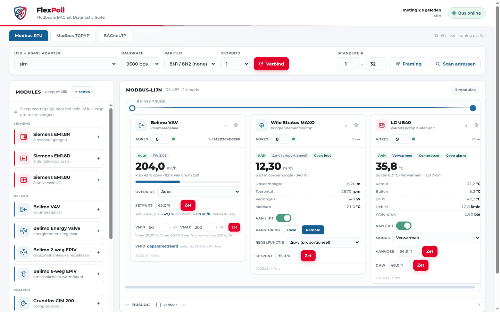

# FlexPoll

**Modbus & BACnet Diagnostic Suite** — een grafische testbank voor de werkbank en
de werf. Eén Python-proces, een browser als front-end, geen cloud.

Gemaakt door **Free van Nieuwenhove**, met de hulp van **Luc** (AI-copiloot).

*A graphical diagnostic bench for HVAC fieldbuses — Modbus RTU over RS-485,
Modbus TCP/IP and BACnet/IP. Stand-alone: Python standard library plus
`pyserial`, no framework, no build step, no cloud.*



---

## Wat het doet

**Modbus RTU (RS-485)**
- Lijn samenstellen uit sleepbare modules: Siemens EM1.8x, Belimo VAV/EV/EPIV,
  Grundfos CIM 200, Wilo, LG, Carrier, Clivet (master/slave), Daikin.
- Scannen met confidence-percentage en framing-zoektocht (baud/pariteit/stopbits).
- Actuatoren bedienen, meetwaarden volgen, busverkeer loggen.
- Algemene deelnemer: eigen registers definiëren (FC 1–4, u16/s16/u32/s32/
  float32/bit, woord- en bytevolgorde, schaling, offset, lezen/schrijven).

**Modbus TCP/IP**
- Dezelfde tegel per toestel: IP + poort + unit-id, geen gedeelde lijn.

**BACnet/IP**
- Who-Is in het subnet (broadcast automatisch afgeleid van de eigen interface,
  plus een limited broadcast — geen hardcoded subnet).
- Objecten lezen en schrijven (analoog, binair, multi-state).
- **EDE-export volgens B.I.G.-EU layout 2.3**: vier CSV-bestanden in één zip
  (`_EDE`, `_ObjTypes`, `_StateTexts`, `_Units`), puntkomma, CRLF, UTF-8 BOM.

## Installatie

Vier wegen, van licht naar zwaar. Ze leveren allemaal hetzelfde: een web-UI op
poort 8099 die met je eigen seriële poort en je eigen netwerk praat.

### Linux — één script

```bash
curl -fsSL https://raw.githubusercontent.com/fvannieuwenhove/flexpoll/main/scripts/install.sh \
  | sudo bash -s --
# of, als je de repo al hebt:
sudo scripts/install.sh              # kloont naar /opt/flexpoll, maakt venv + service
sudo scripts/install.sh --update     # git pull + herstart
sudo scripts/install.sh --uninstall  # service weg, data blijft
```

Zet je gebruiker in de `dialout`-groep, anders kan de app de adapter niet openen:

```bash
sudo usermod -aG dialout "$USER" && sudo systemctl restart flexpoll
```

### Docker

```bash
docker run -d --name flexpoll -p 8099:8099 \
  --device /dev/serial/by-id/usb-FTDI_...-if00-port0:/dev/ttyUSB0 \
  --group-add dialout -v flexpoll-data:/data \
  ghcr.io/freevn/flexpoll:latest
```

Of met compose: `docker compose -f docker/docker-compose.yml up -d` — de
[`docker-compose.yml`](docker/docker-compose.yml) staat in `docker/`, net als de
[`Dockerfile`](docker/Dockerfile). De build-context blijft de repo-root, dus zelf
bouwen gaat met:

```bash
docker build -f docker/Dockerfile -t flexpoll .
```

Voor BACnet/IP-discovery heb je `--network host` nodig: UDP-broadcast over een
brug gaat de deur niet uit.

### Zelfstandige build (Windows .exe, Linux, macOS)

Download de zip/tar van de [releases](https://github.com/FreeVN/FlexPoll/releases),
pak uit en start `FlexPoll/flexpoll` (Windows: `flexpoll.exe`). Er is geen Python
nodig; de browser opent vanzelf. De config komt in je gegevensmap
(`%APPDATA%\FlexPoll`, `~/Library/Application Support/FlexPoll`,
`~/.local/share/FlexPoll`), niet naast de binary.

Zelf bouwen:

```bash
make dist     # pyinstaller flexpoll.spec → dist/FlexPoll/
```

De builds zijn niet ondertekend. Windows SmartScreen zal waarschuwen
("Meer informatie" → "Toch uitvoeren"), macOS wil rechtsklik → Open. Wil je dat
niet, gebruik dan de Docker- of script-route.

### Vanuit de source

```bash
git clone <repo-url> flexpoll && cd flexpoll
python3 -m venv .venv && .venv/bin/pip install -r requirements.txt
.venv/bin/python app.py --port 8099
```

Open `http://<host>:8099`.

> **Let op:** FlexPoll heeft geen authenticatie. Zet hem op een besloten netwerk
> of achter Tailscale/VPN, niet rechtstreeks op het internet.

De configuratie staat in `data/config.json` (bij een broninstallatie) of in de
gegevensmap hierboven (bij een ingepakte build) — overschrijfbaar met
`FLEXPOLL_DATA`. Die map staat in `.gitignore`: ze bevat de echte opstelling
(poorten, IP's, modulelijsten) en gaat nooit mee in een release.

## Zonder hardware

```bash
MODBUS_SIM=1 .venv/bin/python app.py --port 8098   # RTU-simulator
.venv/bin/python modbus_tcp_slave.py               # Modbus TCP-testslave :5020
.venv/bin/python tests/bacnet_slave.py             # BACnet/IP-testslave :47808
```

De simulator is de nep-bus achter de RTU-tab; de twee slaves zijn echte
tegenpartijen voor de TCP- en BACnet-tab.

## Bestanden

| Bestand | Rol |
|---|---|
| `app.py` | HTTP-server, polling-lus, REST-API |
| `devices.py` | moduleprofielen, registers, decoders, schrijfacties |
| `modbus_rtu.py` | RTU-master (CRC16, framing, tracer) |
| `modbus_tcp.py` | Modbus TCP-client (MBAP) |
| `bacnet.py` | BACnet/IP-client, error-PDU-decodering, EDE-export |
| `sim.py` | RTU-simulator |
| `modbus_tcp_slave.py`, `tests/bacnet_slave.py` | testslaves |
| `static/` | front-end (vanilla JS, geen build-stap) |
| `scripts/install.sh` | Linux: klonen, venv, systemd-unit, update, uninstall |
| `scripts/release.sh` | versie bumpen + changelog-kop + commit + tag |
| `scripts/smoke.py` | rooktest tegen de simulator (ook in CI) |
| `scripts/deploy.sh` | deploy naar een remote host (tar over ssh) |
| `flexpoll.spec` | PyInstaller-recept voor de zelfstandige builds |
| `docker/Dockerfile`, `docker/docker-compose.yml` | container-image met volume voor `data/` (`.dockerignore` blijft in de root: die hoort bij de context) |

## Ontwikkelen

```bash
make check    # syntaxis + versie-consistentie + licentieheaders
make smoke    # simulator starten, /api/state bevragen, opruimen
```

Zie [`CONTRIBUTING.md`](CONTRIBUTING.md). De CI draait dezelfde controles op elke
push en pull request.

## Versiebeheer

[Semantic Versioning](https://semver.org/lang/nl/), één bron van waarheid in
[`VERSION`](VERSION). De UI toont de versie in de footer, `app.py --version`
geeft ze op de commandolijn, en de git-tag is `v<VERSION>`. Wat er per versie
veranderd is, staat in [`CHANGELOG.md`](CHANGELOG.md).

Een release maken:

```bash
scripts/release.sh 1.1.0     # VERSION + CHANGELOG-kop bijwerken, commit, tag
git push --follow-tags
```

## Licentie

Code: **GNU Affero General Public License v3.0** (`AGPL-3.0-only`) — zie
[`LICENSE`](LICENSE).

FlexPoll is een netwerkdienst, dus **§13** is van toepassing: wie een gewijzigde
versie host en andere gebruikers laat interageren, moet hun de broncode van die
gewijzigde versie aanbieden. Intern gebruik binnen één organisatie is geen
verspreiding — je eigen testbank draaien mag dus zonder meer.

De naam **FlexPoll** en het schild-logo vallen **niet** onder de licentie
(AGPL §7(e)). Zie [`NOTICE`](NOTICE).

BACnet is een gedeponeerd merk van ASHRAE, Modbus van Schneider Electric. Dit
project is niet verbonden aan of goedgekeurd door beide.
