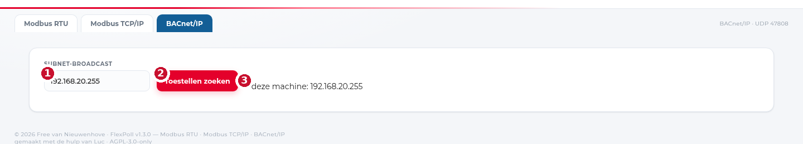

# BACnet/IP

BACnet/IP praat over **UDP-poort 47808** en gebruikt geen adressen maar
**device-instances**. Toestellen vinden elkaar via *Who-Is* (een broadcast) en
antwoorden met *I-Am*.

## Toestellen zoeken

1. Kies het tabblad **BACnet/IP**.
2. Laat **Subnet-broadcast** leeg: de tool vult zelf het broadcastadres van je
   netwerkkaarten in.
3. Klik **Toestellen zoeken**.

1. **Subnet-broadcast** — leeg laten mag. Vul je iets in, dan gaat de Who-Is alleen
   naar dat adres (bv. `192.168.1.255` als je zeker weet dat de toestellen daar
   zitten).
2. **Toestellen zoeken** — stuurt Who-Is en wacht enkele seconden op I-Am.
3. **deze machine: …** — het broadcastadres dat de tool zelf gevonden heeft. Staat
   hier niets, dan kon hij je netwerkkaart niet lezen; vul dan manueel een
   broadcastadres in.

Elk gevonden toestel verschijnt als kaart met **device-instance**, naam en
vendor. Klik erop om de objecten te lezen.

## Objecten lezen en schrijven

De puntenlijst toont per object het type (AI, AO, AV, BI, BO, BV, MSV, …), de
instance, de naam en de huidige waarde.

- **Lezen** werkt op alle objecttypes.
- **Schrijven** kan alleen op **analoge uitgangen/waarden, binaire
  uitgangen/waarden en multi-state** objecten. Sensoren en statusobjecten zijn
  read-only — dat is geen beperking van de tool, maar van BACnet zelf.

!!! warning "Schrijven op een gebouwbeheersysteem"
    Een BACnet-write gaat rechtstreeks naar de regelaar en kan een klep, pomp of
    setpunt verzetten. Op een live installatie doe je dit alleen met toestemming,
    en je noteert de oude waarde (die staat in de kolom voor je klikt).

## EDE-export

Klik **EDE (ZIP)** bij een toestel. Je krijgt een zip met de puntenlijst in het
**B.I.G.-EU layout 2.3**-formaat: vier CSV-bestanden (objecten, staten, eenheden
en de projectkop) die een gebouwbeheerder rechtstreeks kan inlezen.

Vul eerst een **projectnaam** in als je die wil laten meelopen in de bestandsnaam;
anders gebruikt de tool de devicenaam.

## Waarom zie ik geen toestellen?

In volgorde van waarschijnlijkheid:

1. **Andere VLAN of subnet.** Broadcast gaat niet over een router. Zet FlexPoll in
   hetzelfde VLAN als de toestellen, of vul het broadcastadres van dat subnet in
   (dan moet de router wel directed broadcast doorlaten).
2. **Firewall.** UDP 47808 moet open, inkomend én uitgaand.
3. **Wi-Fi client isolation.** Op een gastnetwerk kunnen clients elkaar niet zien,
   dus ook geen broadcast.
4. **BBMD.** In een gebouw met BACnet-routing moet je bij een BBMD registreren.
   FlexPoll doet dat niet; zet hem dan in hetzelfde subnet als de toestellen.
5. **BACnet/SC of MS/TP.** Dat zijn andere transporten; deze tool doet alleen
   BACnet/IP (Annex J).

## Grenzen

- Geen **ReadPropertyMultiple**: elk punt wordt apart gelezen. Bij een toestel met
  200 punten duurt de eerste keer laden dus even.
- Geen **BBMD-registratie** en geen foreign device.
- Geen **BACnet/SC** (Secure Connect) en geen MS/TP.
