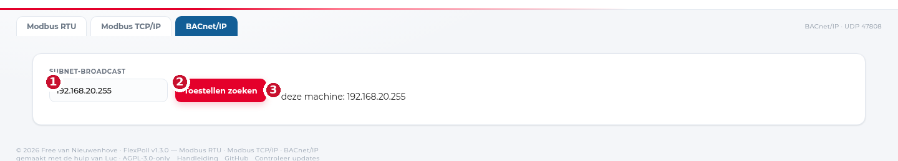

# BACnet/IP

BACnet/IP praat over **UDP-poort 47808** en gebruikt geen adressen maar
**device-instances**. Toestellen vinden elkaar via *Who-Is* (een broadcast) en
antwoorden met *I-Am*.

## Toestellen zoeken

1. Kies het tabblad **BACnet/IP**.
2. Laat **Subnet-broadcast** leeg: de tool vult zelf het broadcastadres van je
   netwerkkaarten in.
3. Klik **Toestellen zoeken**.

1. **Subnet-broadcast** — leeg laten mag. Vul je iets in, dan gaat de Who-Is alleen
   naar dat adres (bv. `192.168.1.255` als je zeker weet dat de toestellen daar
   zitten).
2. **Toestellen zoeken** — stuurt Who-Is en wacht enkele seconden op I-Am.
3. **deze machine: …** — het broadcastadres dat de tool zelf gevonden heeft. Staat
   hier niets, dan kon hij je netwerkkaart niet lezen; vul dan manueel een
   broadcastadres in.

Elk gevonden toestel verschijnt als kaart met **device-instance**, naam en
vendor. Klik erop om de objecten te lezen.

## Objecten lezen en schrijven

De puntenlijst toont per object het type (AI, AO, AV, BI, BO, BV, MSV, …), de
instance, de naam en de huidige waarde.

- **Lezen** werkt op alle objecttypes.
- **Schrijven** kan alleen op **analoge uitgangen/waarden, binaire
  uitgangen/waarden en multi-state** objecten. Sensoren en statusobjecten zijn
  read-only — dat is geen beperking van de tool, maar van BACnet zelf.

!!! warning "Schrijven op een gebouwbeheersysteem"
    Een BACnet-write gaat rechtstreeks naar de regelaar en kan een klep, pomp of
    setpunt verzetten. Op een live installatie doe je dit alleen met toestemming,
    en je noteert de oude waarde (die staat in de kolom voor je klikt).

## EDE-export

Klik **EDE (ZIP)** bij een toestel. Je krijgt een zip met de puntenlijst in het
**B.I.G.-EU layout 2.3**-formaat: vier CSV-bestanden (objecten, staten, eenheden
en de projectkop) die een gebouwbeheerder rechtstreeks kan inlezen.

Vul eerst een **projectnaam** in als je die wil laten meelopen in de bestandsnaam;
anders gebruikt de tool de devicenaam.

## Toestel achter een router: toevoegen op IP

Lezen is unicast (ReadProperty naar het IP van het toestel), dus je hebt **geen
netwerkaanpassing** nodig om punten te bekijken. Vul bij **Toestel op IP** het
adres in en klik **Toevoegen**:

- Laat je **Device-id** leeg, dan stuurt FlexPoll een **unicast Who-Is** naar dat
  adres en neemt het eerste antwoord (I-Am) over.
- Ken je het device-id, vul het dan zelf in; FlexPoll leest dan meteen naam,
  model en vendor.
- Het toestel blijft bewaard in `config.json` (badge **opgeslagen**) en heeft een
  **×** om het te verwijderen. Scannen en opgeslagen toestellen staan in één
  lijst; een scan wist ze niet.

## Scannen over een router: BBMD (Foreign Device)

Een **Who-Is** is een broadcast en die gaat niet door een router. Staat er in het
andere subnet een **BBMD** (Broadcast Management Device), meld je dan aan met
**BBMD (Foreign Device)**:

1. Vul het IP en de poort (standaard 47808) van de BBMD in en een **TTL** in
   seconden (30–300 is gebruikelijk).
2. Klik **Aanmelden**. FlexPoll stuurt `Register-Foreign-Device` (BVLC `0x05`) en
   toont "aangemeld bij … · nog Ns".
3. De registratie wordt automatisch herhaald vóór de TTL verloopt (op TTL/2) en
   na een herstart opnieuw uitgevoerd. Is de BBMD onbereikbaar, dan vervalt de
   registratie met een waarschuwing in het log — lezen blijft gewoon werken.
4. Leeg het veld en klik opnieuw op **Aanmelden** om af te melden.

FlexPoll is **zelf geen BBMD**: het meldt zich alleen aan bij een bestaande. Die
BBMD hoort door het netwerk of de gebouwcontroller geleverd te worden. Let op:
een BBMD werkt met IP-adressen in de payload, dus **NAT** tussen de subnetten
breekt het.

Deze werking is end-to-end getest tegen een onafhankelijke BBMD (bacpypes3) en
een echt toestel achter een router; de opstelling staat in
`tests/bbmd-lab/` in de repo (Docker, twee bruggen, geen NAT).

## Waarom zie ik geen toestellen?

In volgorde van waarschijnlijkheid:

1. **Andere VLAN of subnet.** Broadcast gaat niet over een router. Vul het IP van
   het toestel in bij **Toestel op IP**, of meld je aan bij de BBMD van dat subnet.
2. **Firewall.** UDP 47808 moet open, inkomend én uitgaand.
3. **Wi-Fi client isolation.** Op een gastnetwerk kunnen clients elkaar niet zien,
   dus ook geen broadcast.
4. **BACnet/SC of MS/TP.** Dat zijn andere transporten; deze tool doet alleen
   BACnet/IP (Annex J) — MS/TP heeft een eigen tab.
5. **Verkeerd device-id.** Bij handmatig toevoegen met een id dat niet bestaat,
   antwoordt het toestel met `unknown-object`; laat het veld dan leeg.

## Grenzen

- Geen **ReadPropertyMultiple**: elk punt wordt apart gelezen. Bij een toestel met
  200 punten duurt de eerste keer laden dus even.
- **Geen eigen BBMD-service**: FlexPoll kan zich als Foreign Device aanmelden,
  maar geen broadcasts voor andere clients doorgeven (BDT/FDT-relay).
- Geen **BACnet/SC** (Secure Connect).
