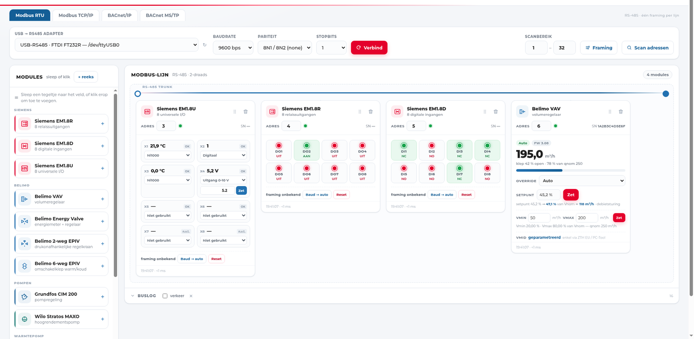
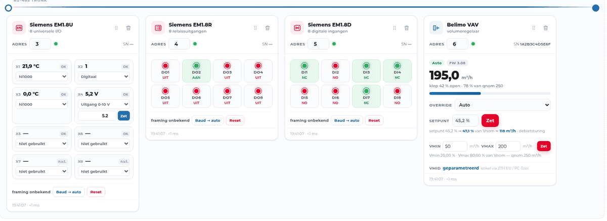

# Demo — eerst kijken, dan installeren

Je hoeft geen adapter, kast of klant te hebben om te zien hoe FlexPoll werkt.
De app heeft een **gesimuleerde bus**: hij antwoordt als een echte Siemens
EM1.8x, Belimo VAV of Grundfos-pomp, met dezelfde registers en dezelfde
framing-ellende. Alleen de cijfers zijn verzonnen.



Dit is de demo-opstelling: vier modules op één RS-485-lijn, elk met hun eigen
kaart. Van links naar rechts een **EM1.8U** (universele I/O), een **EM1.8R**
(relais), een **EM1.8D** (digitale ingangen) en een **Belimo VAV** met debiet,
klepstand en setpunt.

## Wat je in de demo ziet

- **Live meetwaarden per kanaal** — temperatuur, 0–10 V, digitale standen,
  debiet in m³/h, met de eenheid en de schaal die het toestel echt gebruikt.
- **Framing per module** — staat de baudrate of pariteit verkeerd, dan zegt de
  kaart dat, in plaats van een leeg vak met een groen bolletje.
- **Schrijven** — relais aan/uit, setpoints en override-standen, met de
  terugrekening naar het registerformaat.
- **Buslog** — elke lees- en schrijfactie met tijdstempel en foutcode.

## Relais schakelen

Klik op een DO en de module schakelt, de LED springt en de buslog noteert de
write. Zo voelt de bank ook zonder hardware:



## Zelf draaien

De simulator zit in de gewone app; je start hem met `--simulate`.

**Vanuit de bron** (Python 3.10+):

```bash
git clone https://github.com/FreeVN/FlexPoll.git
cd FlexPoll
python3 -m venv .venv && .venv/bin/pip install -r requirements.txt
FLEXPOLL_DATA=/tmp/flexpoll-demo .venv/bin/python app.py --simulate --port 8099
```

**Windows-bundel:** pak de zip uit de
[releases](https://github.com/FreeVN/FlexPoll/releases) uit en start:

```bat
flexpoll.exe --simulate
```

Open daarna <http://127.0.0.1:8099> en sleep de tegels uit de linkerkolom naar de
lijn (Siemens op adres 3, 4 en 5, Belimo op 6 — de simulator kent die adressen).
De configuratie blijft bewaard in de gegevensmap, dus de volgende start staat je
opstelling er weer.

## Wat de demo niet doet

Wees daar eerlijk over: een demo is geen werf.

- **Geen echte hardware.** Er gaat niets over een seriële poort; de simulator
  vervangt de bus volledig.
- **BACnet blijft leeg.** Who-Is is een UDP-broadcast en die gaat niet over het
  internet; zonder toestel in je eigen netwerk vind je niets. De BACnet-tab,
  objecten lezen en de EDE-export werken pas met een echt toestel of een
  BACnet-slave naast je.
- **MS/TP heeft een echte slave nodig** om iets zinnigs te tonen.
- **Geen authenticatie.** FlexPoll is een diagnosetool voor een besloten
  netwerk, geen publieke dienst. Draai de demo lokaal, niet op een open poort.
