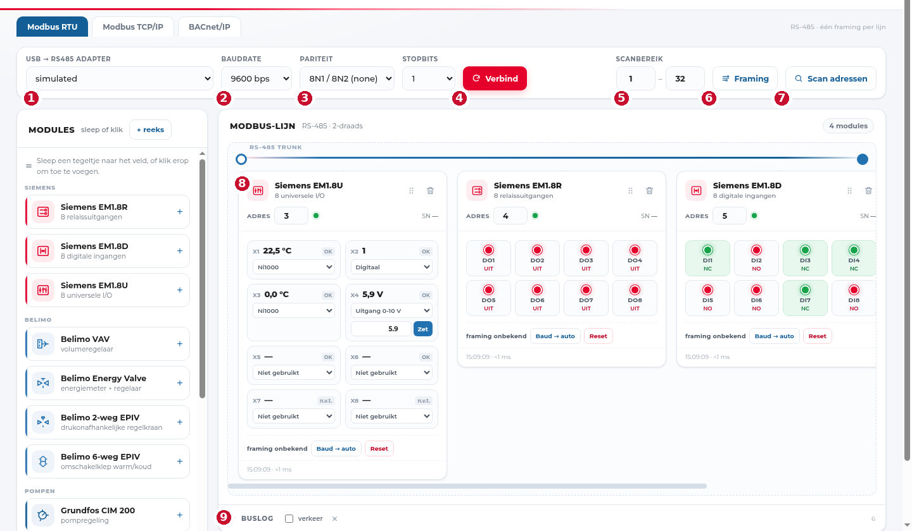

# FlexPoll — handleiding

FlexPoll is een **testbank voor HVAC-veldbussen**: je sluit een USB-RS485-adapter
(of je netwerk) aan, en in de browser zie je wat er op de lijn gebeurt. Geen
installatie van een SCADA-pakket, geen licentie, geen cloud.

Je kan ermee:

- **Modbus RTU** over RS-485: de framing zoeken (baudrate, pariteit, stopbits),
  een adresbereik scannen, modules op een lijn zetten en live meetwaarden lezen.
- **Modbus TCP/IP**: hetzelfde, maar per toestel over het netwerk.
- **BACnet/IP**: toestellen zoeken met Who-Is, hun objecten lezen en schrijven,
  en de puntenlijst als **EDE-pakket** exporteren voor de gebouwbeheerder.

## Voor wie

Deze handleiding is voor wie de tool **gebruikt**: de technieker op de werf, de
commissingenieur die een VAV of pomp moet uitzoeken, de student die een Modbus-lijn
leert doormeten. Je hoeft geen Python te kennen.

!!! warning "Vroege bèta"
    FlexPoll werkt en heeft op echte hardware gedraaid (Siemens EM1.8x,
    Belimo VAV-Compact, Grundfos CIM 200, BACnet-toestellen), maar het is **geen
    afgewerkt product**. Registermaps zijn deels onvolledig en merkspecifiek, het
    configformaat kan wijzigen tussen minor-versies, en er is **geen
    authenticatie**: zet het op een besloten netwerk, niet op het internet.

## De twee manieren om te werken

| Situatie | Wat je nodig hebt | Waar te beginnen |
|---|---|---|
| Je staat aan een kast met een RS-485-lijn | USB-RS485-adapter + FlexPoll | [Modbus RTU](modbus-rtu.md) |
| Het toestel hangt aan het netwerk | alleen FlexPoll, geen adapter | [Modbus TCP/IP](modbus-tcp.md) |
| Je moet BACnet-toestellen vinden | FlexPoll op hetzelfde VLAN | [BACnet/IP](bacnet.md) |

## Scherm in één oogopslag

1. **Adapter** — de USB-RS485-stick. Staat hij er niet? Zie [problemen](problemen.md).
2. **Baudrate** — moet exact kloppen; anders krijg je timeouts of rommel.
3. **Pariteit** — 8N1 is de norm, 8E1 komt voor bij oudere toestellen.
4. **Verbinden** — opent de poort.
5. **Scanbereik** — de adressen die je wil aftasten (1–247).
6. **Framing** — laat de tool zelf zoeken welke instellingen het toestel op het
   eerste adres van je bereik gebruikt.
7. **Scan adressen** — zoekt alle toestellen in het bereik en toont ze met een
   betrouwbaarheidsscore.
8. **Modulekaart** — één toestel op je lijn, met live waarden.
9. **Buslog** — wat er over de lijn gaat, met tijdstempels en fouten.

Verder: bovenaan zie je of de bus **online** is en hoe lang geleden de laatste
meting was. Rechts in de titelbalk staat de versie; die heb je nodig als je een
probleem meldt.

## Polling sturen

Rechts bovenaan, naast "meting x s geleden", staat de bediening van de poll-lus:

| Element | Wat het doet |
|---|---|
| **getal + `s`** | Het interval tussen twee meetrondes, **1 tot 60 seconden**. Korter = meer verkeer op de lijn; op een lange RS-485-lijn met veel modules is 5 s realistisch, bij één toestel mag 1 s. |
| ▶ **play** | Polling loopt. |
| ⏸ **pauze** | Stopt met lezen, maar **houdt de poort open** — handig als je even iets wil bekijken zonder de verbinding te verliezen. |
| ⏹ **stop** | Stopt én **geeft de poort vrij**, zodat een ander programma (bv. de tool van de leverancier) de adapter kan gebruiken. |

Het interval wordt bewaard in je configuratie; na een herstart loopt dezelfde
snelheid weer.

## Handleiding en updates

Onderaan de pagina staan twee links (**Handleiding**, **GitHub**) en een knop
**Controleer updates**. Die laatste vraagt aan GitHub wat de nieuwste release is
en zegt of je up to date bent. Werkt de pc niet op het internet, dan zegt hij dat
gewoon — de tool zelf heeft geen internet nodig.
