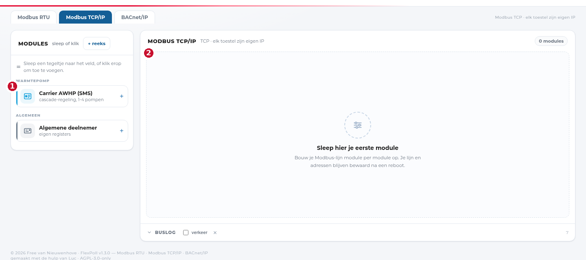

# Modbus TCP/IP

Bij Modbus TCP/IP hangt elk toestel aan het netwerk met zijn eigen IP-adres en
poort (meestal 502). Er is geen gedeelde lijn en dus ook geen adresbereik of
framing: je verbindt per toestel.

## Een toestel toevoegen

1. Kies het tabblad **Modbus TCP/IP**.
2. Sleep het juiste tegeltje uit de linkerkolom (bv. **Carrier AWHP (SMS)** of
   **Algemene deelnemer** voor een toestel dat niet in de lijst staat).
3. Vul het **IP-adres** en, als het afwijkt, de **poort** in.
4. De module leest vanaf dat moment op het ingestelde interval.

1. **Palet** — hier staan de toestellen die de tool kent. Voor HVAC zijn dat
   onder meer Carrier AWHP, Clivet, Daikin en LG UB40; **Algemene deelnemer**
   werkt met elke Modbus-TCP-server waarvan je de registers kent.
2. **Canvas** — leeg tot je een toestel toevoegt. Elk toestel is een aparte
   module; ze delen niets met elkaar.

## Wat anders is dan bij RTU

| | RTU | TCP |
|---|---|---|
| Adressering | unit-id op een gedeelde lijn | IP-adres + poort |
| Framing | baudrate/pariteit/stopbits | niet van toepassing |
| Scannen | adresbereik aftasten | geen scan: je moet het IP kennen |
| Fouten | timeouts, CRC, framing | verbinding geweigerd, geen antwoord |

Een **scan bestaat niet** bij TCP: er is geen adresruimte om af te lopen (en het
scannen van een heel subnet is bovendien iets wat netwerkbeheerders niet graag
zien). Weet je het IP niet, zoek het dan via je DHCP-server, het display van het
toestel of de documentatie.

## Veelvoorkomende poorten

- **502** — de standaard Modbus-TCP-poort.
- **503 of 1502** — sommige gateways en leveranciers wijken af.
- BACnet-toestellen gebruiken **47808/UDP**; dat is een ander protocol, zie
  [BACnet/IP](bacnet.md).

## Netwerk

- Zet de firewall open voor de poort die je gebruikt, **in beide richtingen**.
- Over een VLAN of VPN heen werkt het alleen als de route klopt; Modbus-TCP heeft
  geen discovery, dus "het werkt niet" is meestal een route- of firewallprobleem.
- In Docker: gebruik `--network host` of zorg dat de container bij het juiste
  netwerk zit. Een bridge-netwerk zonder route naar de HVAC-VLAN geeft timeouts.

## Unit-id

Sommige gateways verwachten tóch een unit-id in het TCP-frame (dat heet dan
"Modbus TCP met unit-id", gebruikt bij RTU-over-TCP converters). Staat er in de
documentatie een slave-adres, vul dat dan in bij de module; anders laat je het op
1.
