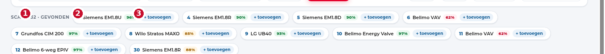

# Je eerste meting

Deze wandeling duurt vijf minuten en gebruikt de **simulator** — je hebt dus nog
geen hardware nodig om te zien hoe het werkt.

## 1. Start met de simulator

```bash
FLEXPOLL_DATA=/tmp/flexpoll-demo flexpoll --simulate --port 8099
```

Of, als je de bron hebt: `MODBUS_SIM=1 python3 app.py --port 8099`.

Open `http://127.0.0.1:8099`. Rechts boven staat **Bus online** en de poort
noemt zich `simulated`.

## 2. Zet een paar modules op de lijn

Klik in de linkerkolom op **Siemens EM1.8U**, **EM1.8R** en **EM1.8D**. Ze
verschijnen op de RS-485-trunk met een adres. Wacht een seconde of tien: de
kaarten vullen zich met meetwaarden.

Je kan ook slepen, of **+ reeks** gebruiken om dertien identieke modules op
opeenvolgende adressen te zetten — dat is hoe een echte VAV-lijn eruitziet.

## 3. Scan eens

Zet **Scanbereik** op `1 – 32` en klik **Scan adressen**:



1. De balk verschijnt onder de knoppen zodra de scan iets vindt.
2. Elk gevonden adres toont het **type** en een **percentage**: hoe zeker de tool
   is dat dit toestel daar zit (gebaseerd op welke registers antwoorden).
3. **+ toevoegen** zet het meteen als module op de lijn — handig als je niet wil
   uitzoeken welk type het is.

## 4. Kijk wat er over de lijn gaat

Onderaan staat de **Buslog**. Vink **verkeer** aan om elk frame te zien:
functiecode, registertype en bereik. Bij een time-out zie je welke module niet
antwoordde, niet alleen "er is iets fout".

## 5. Als het om echte hardware gaat

1. Sluit de USB-RS485-adapter aan.
2. Kies hem bij **Adapter** (bij voorkeur het `/dev/serial/by-id/...`-pad).
3. Zet de baudrate en pariteit die het toestel verwacht — weet je het niet, klik
   **Framing** en laat de tool zoeken.
4. **Verbinden**, dan **Scan adressen**.

!!! tip "Eerst framing, dan pas adressen"
    Een scan met de verkeerde baudrate levert niets op en kost je alleen tijd.
    **Framing** probeert de combinaties op één adres; dat is meestal sneller
    dan blind scannen.
